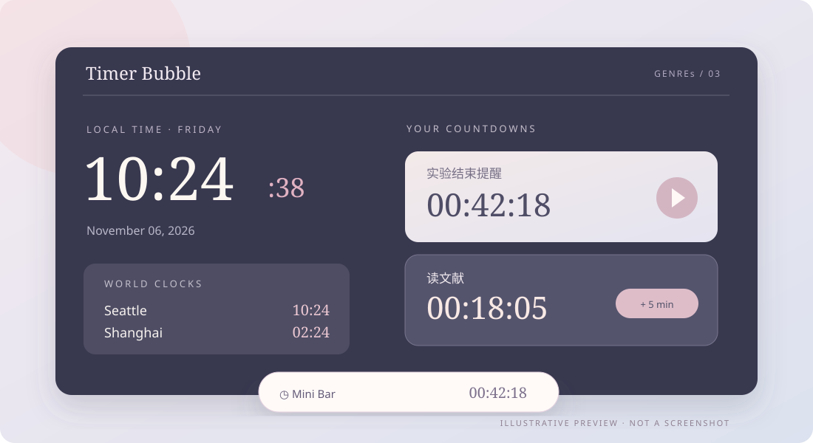

[README.md](https://github.com/user-attachments/files/34538291/README.md)
# Desktop-timer
A customizable desktop companion with floating clocks, multiple countdowns, and world time at a glance.
<p align="center">
  
</p>

<p align="center"><strong>给时间一个位置，也给自己一点余地。</strong><br /><sub>Time, gently in sight.</sub></p>

<p align="center"><code>GENREs / 03</code> · Electron · Windows · 悬浮时钟与倒计时</p>

Timer Bubble 是一组可以放在桌面上的时间小组件：看时钟、记倒计时、关注不同时区，不用反复切换窗口。

### ✦ 你可以做什么

| 看时间 | 盯进度 | 按自己习惯摆放 |
| :--- | :--- | :--- |
| 查看日期、时钟和不同时区 | 同时管理多个倒计时 | 拖动悬浮卡片、调整颜色与布局 |

包括**精简迷你栏**，以及倒计时的**稍后提醒／延长时间**等交互；适合科研实验、工作时段与日常提醒。

### ✦ 界面一瞥

<p align="center"></p>

<sub>图为根据真实功能绘制的视觉示意，时间和倒计时为示例，并非程序截图。</sub>

### ✦ 开始使用

安装 **Node.js ≥ 22.12** 与 npm，在解压后的目录执行：

```bash
npm ci
npm start
```

Windows 用户完成安装后也可以双击 `timer.cmd`。当前提供**源码运行版**。

### ✦ 数据与说明

- 倒计时和界面设置保存在本机 Electron 应用数据目录。
- 时区计算使用 `Luxon`；本工具是日常辅助提醒，**不适合用于安全或医疗关键计时**。
- 仓库不包含用户个人倒计时记录。

<p align="center"><sub>A small pause in the rush, by <strong>GENREs</strong> · Little tools, lovingly made.</sub></p>
